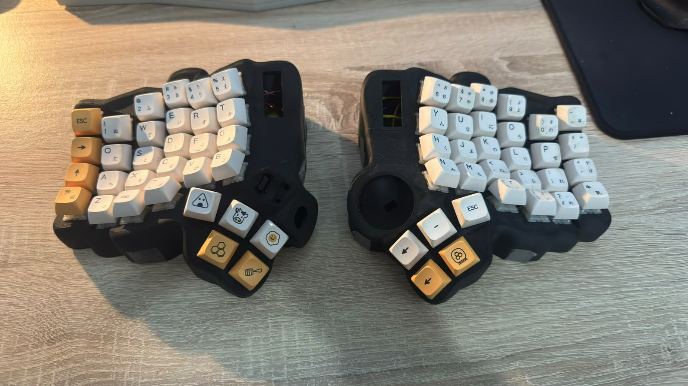
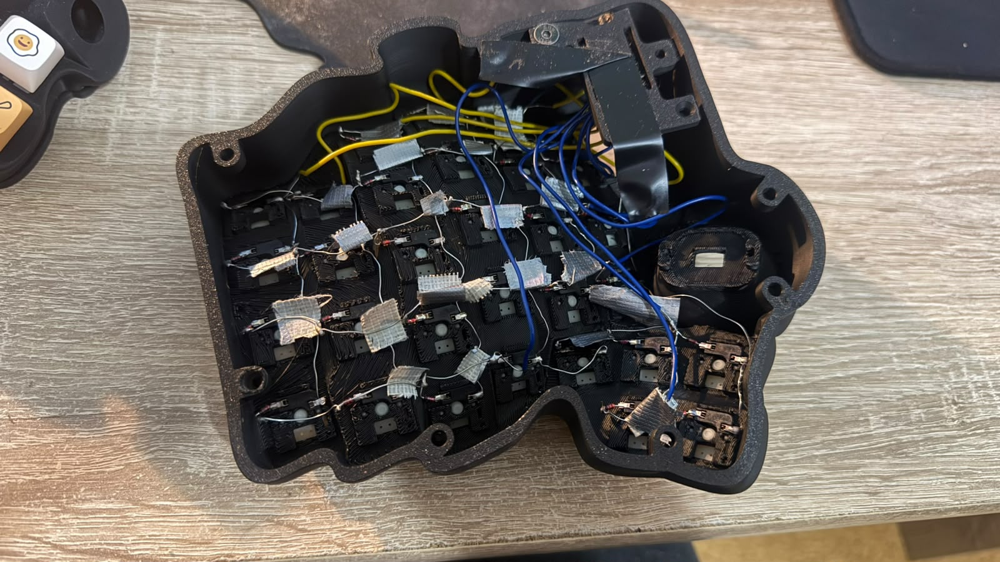

# Dactyl Manuform ZMK Configuration

Custom [ZMK](https://zmk.dev) firmware configuration for a hand-wired Dactyl Manuform (5x6) split ergonomic keyboard, built by soldering the switch and diode matrix and flashing custom QMK/ZMK firmware with multi-layer keymaps (`default`, `lower`, `raise`, and `adjust`). This repository is forked from the [TaikoHub Dactyl Manuform](https://taikohub.com) project and used as the basis for the keyboard's wireless ZMK configuration.

Compatible with `nice_nano` (`nice!nano v2`, `SuperMini nRF52840`, and `Pro Micro nRF52840` controllers; not compatible with BlueMicro). For upstream hardware details and initial setup reference, see the [TaikoHub Dactyl Manuform documentation](https://docs.taikohub.com).

## Gallery/Demo

The wiring is a bit messy due to suboptimal equipment and this being a personal project, but here are some images of the build:





## Repository Structure

- `config/dactyl_manuform_5x6.keymap` — keymap layers and key bindings
- `config/dactyl_manuform_5x6.conf` — ZMK feature flags and Bluetooth configuration
- `config/boards/shields/dactyl_manuform_5x6/` — shield definition, matrix transform, and left/right pin overlays
- `build.yaml` — GitHub Actions build matrix (`dactyl_manuform_5x6_left`, `dactyl_manuform_5x6_right`, and `settings_reset`)

## Building Firmware

1. Edit the layout, features, or shield files under `config/` (for example, `config/dactyl_manuform_5x6.keymap`).
2. Commit and push changes to trigger the **Build ZMK firmware** GitHub Actions workflow (or run it manually from the Actions tab):

   ```bash
   git add config/
   git commit -m "Update keymap"
   git push
   ```

3. Once the workflow finishes, download `firmware.zip` from the run's **Artifacts** section and flash the generated `.uf2` files to each keyboard half.
